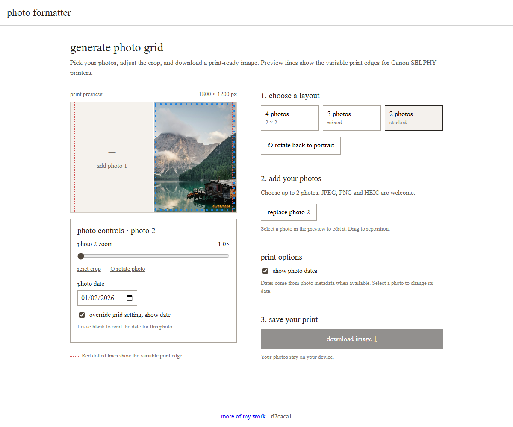
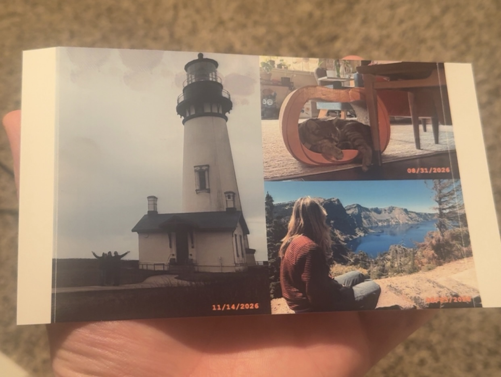

# 📷 Photo Formatter - [Visit the site](https://bmitchinson.github.io/photo-grid-creation-tool/)

Arrange two, three, or four photos into a print-ready grid. Adjust each crop and download the result as a JPEG in portrait or landscape. The preview shows the variable print edges for Canon SELPHY printers.

Photos are processed on your device. HEIC and HEIF files use a local conversion fallback when the browser cannot open them directly.

Example printed result:

## How it was built

- Model: OpenAI GPT-6.1 Terra
- Coding agent: Pi, running under Herdr
- Build machine: home lab Windows desktop running WSL
- Remote access: Tailscale and Heeler on iOS

## Development

Run `npm install`, then `npm run dev`. Run `npm run check`, `npm test`, and `npm run build` to verify changes. Pushes to `main` deploy to GitHub Pages.

## Printer reference

[Canon SELPHY CP1500 advanced user guide](docs/canon-selphy-cp1500-manual.pdf) ([original PDF](https://cam.start.canon/en/P001/manual/p001.pdf)).
